<div align="center">

# 🧭 stackwise

**Stack-aware pull request review for .NET + Node.js + React, as a Claude Code plugin.**

It reads the diff, loads only the checklists for the stacks the change touches, scales its
depth to the risk, and reports findings it can prove: file:line, the defect, an input that
breaks it, the fix. Then it can fix them, pin them with tests, answer the review threads and
write the PR description.

[](LICENSE)


[Quick start](#-quick-start) · [What's inside](#-whats-inside) · [Example](#-what-a-review-looks-like) · [What it catches](#-what-it-catches) · [How it works](#%EF%B8%8F-how-it-works) · [CI](#-run-it-in-ci) · [Hooks](#-hooks) · [Changelog](CHANGELOG.md)

</div>

---

## ✨ Why stackwise

- **🎯 Diff-driven, not repo-driven.** A React-only PR never loads the EF Core checklist. The review spends its context on the code that changed, and reads only the checklist part of each reference until an item hits.
- **🔬 Proof or it's dropped.** Every finding names the line, the input that breaks it and the fix, and is labelled `confirmed` or `likely: assumes …`. Unproven concerns become questions, not findings.
- **⚖️ Depth follows risk, not size.** Auth, money, migrations, concurrency and public contracts get a deep pass; a copy change gets a light one.
- **🔗 Catches the bugs between layers.** A vertical pass follows one feature from the migration to the React component. A horizontal pass compares new handlers with their siblings.
- **🌉 Owns the C# ↔ TypeScript seam.** Nullability on the wire, int-vs-string enums, `DateTime` kinds, `long` past 2^53 and stale generated clients get their own checklist.
- **🧵 Fans out only when it pays.** Large or risky diffs go to five lens agents in parallel, none of which can edit; small ones stay a single pass.
- **🤫 Quiet by default.** It doesn't flag formatting, lint-owned rules or taste, and posts nothing unless you ask.

## 🚀 Quick start

**As a Claude Code plugin** (everything: skills, command, lens agents, hooks):

```
/plugin marketplace add devmaxxx/stackwise
/plugin install stackwise@stackwise
```

Restart Claude Code, then in any repo:

```
/stackwise:review
```

Needs `git`, Node.js 18+ on `PATH` for the hooks, and an authenticated
[GitHub CLI](https://cli.github.com/) for PR targets.

**As plain skills**, with the [`skills` CLI](https://www.npmjs.com/package/skills):

```sh
npx skills add devmaxxx/stackwise                  # pick the agent interactively
npx skills add devmaxxx/stackwise -a claude-code
```

That installs the five skills only, with no `/stackwise:review` command. The lens agents
and the hooks need the plugin; without the agents, the review runs its lenses inline.

## 📦 What's inside

| Piece | What it does | How to use it |
|-------|--------------|---------------|
| `stackwise` skill | The review: stack detection, risk depth, vertical and horizontal passes, four lenses, verification, must / should / nit | Ask *"review this PR"*, or `/stackwise:stackwise` |
| `/stackwise:review` command | The review with target resolution and optional posting | `/stackwise:review [PR#\|branch\|path\|file.diff] [--comment]` |
| `stackwise-fix` skill | One minimal patch per must and should finding, rebuilt and tested, breaking input re-run, failures reverted | *"fix the review findings"*, or `/stackwise:stackwise-fix [PR#\|branch\|path\|review-file] [--commit] [--only must]` |
| `stackwise-tests` skill | A regression test per finding that fails before the fix and passes after, in the repo's framework | *"pin these fixes with tests"*, or `/stackwise:stackwise-tests [finding numbers\|path] [--keep-red]` |
| `stackwise-respond` skill | Reads unresolved review threads, classifies each as valid, wrong or question, fixes the valid ones, drafts the replies | *"address the review comments"*, or `/stackwise:stackwise-respond [PR#\|URL] [--post] [--commit]` |
| `stackwise-describe` skill | PR title and body with a risk note for migrations, the C# ↔ TS contract, auth and config | *"write the PR description"*, or `/stackwise:stackwise-describe [PR#\|branch] [--apply]` |
| Lens agents | `stackwise-contract`, `stackwise-data`, `stackwise-auth`, `stackwise-react-effects`, `stackwise-silent-failure`: one lens each, no Write or Edit tool | Dispatched by the review for large or risky diffs, or ask for one by name: *"run the stackwise:stackwise-auth agent on this branch"* |
| Security hook | Warns when a `Write` or `Edit` adds a secret, raw SQL built from strings, `dangerouslySetInnerHTML`, `[AllowAnonymous]`, `eval`, a shell `exec` with a template string or disabled TLS checks | On by default; `STACKWISE_SECURITY_HOOK=0` turns it off |
| Pre-push hook | On `git push`, names the outgoing commits and asks for a review of them | Off by default; `STACKWISE_PREPUSH=1` turns it on |
| CI template | Runs the review on pull requests and posts inline comments | Copy [templates/github/stackwise-review.yml](templates/github/stackwise-review.yml) |

Nothing here approves, requests changes, resolves threads or pushes. Posting to GitHub
happens only with `--comment`, `--post`, `--apply` or the CI template.

## 🕹️ Usage

| Command | Reviews |
|---------|---------|
| `/stackwise:review` | the open PR for the current branch, else local changes vs base |
| `/stackwise:review 123` | PR #123 |
| `/stackwise:review feat/orders` | a branch vs its base |
| `/stackwise:review src/Api` | the branch diff, limited to a path |
| `/stackwise:review change.diff` | a `.diff` or `.patch` file |
| `/stackwise:review 123 --comment` | PR #123, and posts the findings as one review with inline comments |

`--comment` posts a single `COMMENT` review through `gh api`. A typical loop after a review:

```
/stackwise:stackwise-fix                     # patch the must and should findings, uncommitted
/stackwise:stackwise-tests                   # red-before, green-after test per fixed finding
/stackwise:stackwise-describe 123 --apply    # write the PR title and body
/stackwise:stackwise-respond 123             # draft replies; add --post to send them
```

## 👀 What a review looks like

```markdown
## Review: Add invoice HTML view (main...feat/invoice-view)
Stacks: Node.js (Express 4) · References loaded: nodejs, security, testing, error-handling
Risk: none · Depth: standard · Lens agents: single pass
Verdict: request changes

### must
1. `server/routes/invoices.js:18` — async handler never forwards errors; Express 4
   ignores the returned promise. (confirmed)
   Breaks when: `db.query` rejects (`req.params.id = "abc"` against an int column):
   the request hangs and Node 15+ crashes on the unhandled rejection.
   Fix: `try { … } catch (err) { next(err) }`, as the sibling `GET /` does.

### should
2. `server/routes/invoices.js:26` — `fs.readFileSync` on every request blocks the
   event loop. (confirmed)
   Breaks when: a burst of invoice views stalls every in-flight request.
   Fix: read the template once at module load.

Checked and fine: owner scoping on the query, SQL parameterization, the 404 path.
```

Findings are numbered so the author can reply *"fixed 1, disagree on 2"*.

## 🧪 What it catches

| Area | Highlights |
|------|-----------|
| **C# / .NET** | sync-over-async, `async void`, dropped `CancellationToken`, nullable `!` lies, disposal, multiple enumeration, `Parallel.ForEachAsync` with shared state, illegal states in new types |
| **ASP.NET Core** | captive dependencies, background workers without scopes, `[Authorize]` gaps, IDOR, over-posting, `HttpClient` lifetime, `ProblemDetails` leaks, rate limits, forwarded headers |
| **EF Core and SQL** | N+1, tracking on read paths, cartesian explosion, unbounded queries, `FromSqlRaw` injection, `ExecuteUpdate` caveats, Dapper, migrations that lose data, lock tables or break deploy order |
| **Node.js** | event-loop blocking, floating promises, Express 4 async errors, Fastify reply and hook rules, streams and backpressure, shutdown, `child_process` and path injection |
| **NestJS** | `ValidationPipe` without `whitelist`, nested DTOs never validated, guard and pipe order, request-scoped providers, serialization leaks, transactions |
| **TypeScript** | `as` escapes, no runtime validation at boundaries, `res.ok` unchecked, non-exhaustive unions, optional-field soup, bare ids and units |
| **React** | stale closures, fetch races without abort, effects for derived state, keys, async UI states, XSS, a11y the markup proves |
| **Next.js** | server-only code reaching the client, server actions without auth, auth only in `proxy` or middleware, caching and revalidation mistakes |
| **API design** | idempotency, PATCH semantics, status codes, paging, `ETag`, 202 with a status resource, 429 with `Retry-After` |
| **Performance** | N+1 across stacks, unbounded data, waterfalls, blocking calls, caches without limits, payload and bundle size, re-renders, with a hot-path gate |
| **Error handling** | swallowed errors, lost context, fail-open paths, retries without caps or idempotency, background loops that die, errors shown as empty states |
| **Cross-stack contract** | C# DTO ↔ TS types: nullability, enum encoding, `DateTime` / `DateOnly`, `decimal` / `long` precision, casing, stale generated clients |
| **Security** | access control, tenant isolation, injection, SSRF, auth and sessions, insecure defaults, removed checks, money races |
| **Testing** | is the changed branch tested, and do the tests pin behaviour rather than the implementation |

## ⚙️ How it works

```mermaid
flowchart LR
    A[Diff<br/>PR, branch, path or .diff] --> B{Detect stacks<br/>from changed paths}
    B --> C[Load matching checklists<br/>+ security, testing, error-handling]
    C --> R{Risk:<br/>auth, money, migration,<br/>concurrency, contract?}
    R -->|deep / standard / light| V[Vertical pass<br/>DB → API → client]
    V --> H[Horizontal pass<br/>sibling drift]
    H --> L[Lenses: silent failures,<br/>test coverage, type design,<br/>comment accuracy]
    R -->|over 400 lines or risky| P
    subgraph P[Parallel lens agents, no edit tools]
        P1[contract]
        P2[data]
        P3[auth]
        P4[react-effects]
        P5[silent-failure]
    end
    L --> M[Merge and dedupe]
    P --> M
    M --> F{Verify: line +<br/>breaking input + fix?}
    F -->|yes| G[must / should / nit<br/>confirmed or likely]
    F -->|no| Q[Question or drop]
```



### Stack detection

| Changed paths or code | References loaded |
|-----------------------|-------------------|
| `*.cs`, `*.csproj`, `*.sln`, `Directory.Build.*`, `appsettings*.json` | `dotnet-csharp` |
| `Program.cs`, `Controllers/`, `Endpoints/`, `Middleware/`, `[ApiController]`, `BackgroundService` | `aspnetcore` |
| `Migrations/`, `*DbContext.cs`, entity configurations, `FromSql*`, `ExecuteUpdate*`, Dapper | `efcore` |
| `package.json` without `react`/`next`; `server/`, `api/`, `routes/`; `express`, `fastify`, `pg`, `prisma`, `node:*` | `nodejs` |
| `@nestjs/*`, `nest-cli.json`, `NestFactory`, `*.module/controller/service/guard/pipe/dto.ts` | `nestjs` + `nodejs` |
| `*.ts`, `*.tsx`, `tsconfig*.json` | `typescript` |
| `*.tsx`, `*.jsx`, `package.json` with `react` | `react` |
| `next` in `package.json`, `next.config.*`, `app/**/{page,layout,route}.*`, `middleware.ts`, `proxy.ts`, `'use server'` | `nextjs` + `react` |
| New or changed routes, DTOs, status codes, paging, `ETag`, `Idempotency-Key` | `api-design` |
| List endpoints, `await` or a query inside a loop, `Promise.all` / `Task.WhenAll`, caches, `*Sync(` | `performance` |
| C# DTOs or endpoints together with TS or generated clients | `cross-stack-contract` |
| always | `security`, `testing`; `error-handling` unless the diff is docs-only |

### Cost

The plugin adds about 1.9k tokens to every session: the descriptions of the five skills,
the command and the five agents. A review loads the skill (about 4.4k tokens) and, per
matched reference, its checklist (the first 100 lines, 1.1k to 2.6k tokens), then only the
snippet sections for items that hit.

## 🤖 Run it in CI

[templates/github/stackwise-review.yml](templates/github/stackwise-review.yml) runs the
review on every pull request that touches C#, TypeScript, JavaScript, `package.json`,
migrations or SQL:

1. Copy it to `.github/workflows/stackwise-review.yml`.
2. Add an `ANTHROPIC_API_KEY` repository secret.

It uses `anthropics/claude-code-action` pinned to a version tag, installs this plugin from
its marketplace, posts each must and should finding as an inline comment plus one summary
comment, and never approves, requests changes or pushes. It skips drafts and pull requests
from forks (they get no secrets), and a new push cancels the run for the previous head.

## 🪝 Hooks

Both hooks warn and never block: they always exit 0 and never return a permission
decision. They run with `node`, so Node.js 18+ must be on `PATH`. Set the variables in your
shell before starting Claude Code, or under `env` in `settings.json`:

```json
{ "env": { "STACKWISE_PREPUSH": "1" } }
```

| Hook | Default | Variable | What it does |
|------|---------|----------|--------------|
| Security guard (`PreToolUse` on `Write`, `Edit`, `MultiEdit`) | on | `STACKWISE_SECURITY_HOOK=0` turns it off | Scans only the lines the change adds. Flags secrets (masked in the warning), `FromSqlRaw` / `ExecuteSqlRaw` with interpolation or concatenation, `dangerouslySetInnerHTML` without a sanitizer, `[AllowAnonymous]`, `eval` / `new Function`, `child_process.exec` with a template string, `rejectUnauthorized: false` and certificate callbacks that return true. |
| Pre-push review (`PreToolUse` on `git push`) | off | `STACKWISE_PREPUSH=1` turns it on | Resolves the outgoing commits to shas before the push moves the upstream ref, and asks Claude to review exactly that range and report every must before any further push, PR, merge or deploy. It does not hold the push back; use branch protection or a git `pre-push` hook for a hard gate. |

The security guard misses raw SQL assembled on an earlier line and calls that span several
lines, and it can flag credentials in test fixtures; the review itself covers both. The
pre-push hook sees `git push` at the start of a command, after `&&`, `;` or `cd`, and with
`git -C`; a push inside a subshell, `bash -c` or `xargs` gets no reminder, and neither does
`--dry-run`, a delete or a tag-only push.

## 🗂️ Repository layout

```
.claude-plugin/              plugin.json, marketplace.json
skills/stackwise/            SKILL.md + references/ (14 checklists)
skills/stackwise-fix/        apply findings as tested patches
skills/stackwise-tests/      failing-first regression tests
skills/stackwise-respond/    answer review threads
skills/stackwise-describe/   PR title, body and risk note
agents/                      five lens agents
commands/review.md           /stackwise:review
hooks/                       hooks.json, security-guard.mjs, prepush-review.mjs
templates/github/            stackwise-review.yml for GitHub Actions
evals/                       six seeded-bug fixtures, including the fix eval
tests/                       validate.mjs, hooks.test.mjs
```

## 🛠️ Development

```sh
claude --plugin-dir .     # load your working copy
npm test                  # manifests, frontmatter, links, fixtures, agents, hooks, CI template
```

Each fixture in `evals/` seeds known bugs and lists the findings a good review must report,
may report and must not report. Run them as described in [evals/README.md](evals/README.md).

Blind runs on 2026-10-21, one fresh headless session per fixture:

| Version | Fixtures | Seeded bugs found | False positives | Stack detection | Fix eval |
|---------|----------|-------------------|-----------------|-----------------|----------|
| 0.1.0 | 3 | 6/6 | 1 | 3/3 | none |
| 0.2.0 | 6 | 12/12 | 1 | 6/6 | pass |

The remaining false positive is in the `dotnet` fixture: the ownership check is graded must,
although the fixture's siblings are out of view and the expected answer is a question ([#12](https://github.com/devmaxxx/stackwise/issues/12)).

## 🗺️ Roadmap

- [x] NestJS, Next.js, API design, performance and error-handling checklists
- [x] Risk-scaled depth and the four lenses
- [x] Parallel lens agents for large or risky diffs
- [x] Fix, tests, respond and describe skills
- [x] Advisory security hook and opt-in pre-push hook
- [x] GitHub Actions template
- [x] Fix eval with a scripted check
- [ ] Automated eval runner with hit / miss / false-positive scoring ([#1](https://github.com/devmaxxx/stackwise/issues/1))
- [ ] Plugin icon ([#2](https://github.com/devmaxxx/stackwise/issues/2))
- [ ] Blazor and SignalR checklists ([#3](https://github.com/devmaxxx/stackwise/issues/3))
- [ ] Vue and Angular front-end variants ([#4](https://github.com/devmaxxx/stackwise/issues/4))
- [ ] Security hook: raw SQL built on an earlier line, and multi-line calls ([#5](https://github.com/devmaxxx/stackwise/issues/5))
- [ ] CI template: skip findings already posted on an earlier push ([#8](https://github.com/devmaxxx/stackwise/issues/8))
- [ ] CI template: an end-to-end run on a sample pull request ([#9](https://github.com/devmaxxx/stackwise/issues/9))
- [ ] Fix evals for .NET and React ([#10](https://github.com/devmaxxx/stackwise/issues/10))
- [ ] Review fixtures backed by a repo, so the horizontal pass can run ([#11](https://github.com/devmaxxx/stackwise/issues/11))
- [ ] Lens agents that get the diff and need no Bash ([#15](https://github.com/devmaxxx/stackwise/issues/15))

Known gaps: hook false positives and missed push forms ([#6](https://github.com/devmaxxx/stackwise/issues/6), [#7](https://github.com/devmaxxx/stackwise/issues/7)), severity
and dispatch misses seen in the evals ([#12](https://github.com/devmaxxx/stackwise/issues/12), [#13](https://github.com/devmaxxx/stackwise/issues/13), [#14](https://github.com/devmaxxx/stackwise/issues/14)) and the
per-session token cost ([#16](https://github.com/devmaxxx/stackwise/issues/16)). All of them are in the
[v0.3.0 milestone](https://github.com/devmaxxx/stackwise/milestone/1).

## 📜 License

MIT © 2026 devmaxxx. See [LICENSE](LICENSE) and [ATTRIBUTION.md](ATTRIBUTION.md).
