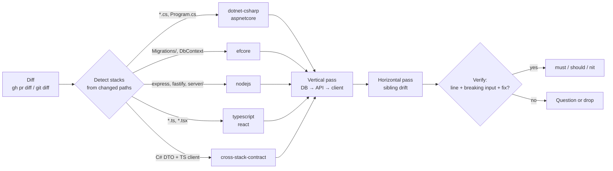

<div align="center">

# 🧭 stackwise

**Stack-aware pull request review for .NET + Node.js + React, as a Claude Code plugin.**

It reads the diff, loads only the checklists for the stacks the change touches, and
reports findings it can prove: file:line, the defect, an input that breaks it, the fix.

[](LICENSE)


[Quick start](#-quick-start) · [Example](#-what-a-review-looks-like) · [What it catches](#-what-it-catches) · [How it works](#%EF%B8%8F-how-it-works) · [Why another review skill](#-why-another-review-skill)

</div>

---

## ✨ Why stackwise

- **🎯 Diff-driven, not repo-driven.** A React-only PR never loads the EF Core checklist. The review spends its context on the code that changed.
- **🔬 Proof or it's dropped.** Every finding names the line, the input that breaks it and the fix. Plausible-but-unproven concerns become questions, not findings.
- **🔗 Catches the bugs between layers.** A vertical pass follows one feature from the migration to the React component. A horizontal pass compares new handlers with their siblings.
- **🌉 Owns the C# ↔ TypeScript seam.** Nullability on the wire, int-vs-string enums, `DateTime` kinds, `long` past 2^53 and stale generated clients get a dedicated checklist. No other public review skill has one.
- **🤫 Quiet by default.** It doesn't flag formatting, lint-owned rules or taste, and posts nothing unless you pass `--comment`.

## 🚀 Quick start

```
/plugin marketplace add devmaxxx/stackwise
/plugin install stackwise@stackwise
```

Restart Claude Code, then in any repo:

```
/stackwise:review
```

Needs `git`, plus an authenticated [GitHub CLI](https://cli.github.com/) for PR targets.

## 🕹️ Usage

| Command | Reviews |
|---------|---------|
| `/stackwise:review` | the open PR for the current branch, else local changes vs base |
| `/stackwise:review 123` | PR #123 |
| `/stackwise:review feat/orders` | a branch vs its base |
| `/stackwise:review src/Api` | the branch diff, limited to a path |
| `/stackwise:review 123 --comment` | PR #123, and posts the findings as one review with inline comments |

`--comment` posts a single `COMMENT` review through `gh api`. It never approves or requests
changes. The skill also fires on its own when you ask Claude to *"review this PR"* or
*"review my branch"* in a repo with these stacks.

## 👀 What a review looks like

```markdown
## Review: Add invoice HTML view (main...feat/invoice-view)
Stacks: Node.js (Express 4) · References loaded: nodejs, security, testing
Verdict: request changes

### must
1. `server/routes/invoices.js:18` — async handler never forwards errors; Express 4
   ignores the returned promise.
   Breaks when: `db.query` rejects (`req.params.id = "abc"` against an int column):
   the request hangs and Node 15+ crashes on the unhandled rejection.
   Fix: `try { … } catch (err) { next(err) }`, as the sibling `GET /` does.

### should
2. `server/routes/invoices.js:26` — `fs.readFileSync` on every request blocks the
   event loop.
   Breaks when: a burst of invoice views stalls every in-flight request.
   Fix: read the template once at module load.

Checked and fine: route auth middleware, SQL parameterization, response status codes.
```

Findings are numbered so the author can reply *"fixed 1, disagree on 2"*.

## 🧪 What it catches

| Stack | Highlights |
|-------|-----------|
| **C# / .NET** | sync-over-async (`.Result`, `.Wait()`), `async void`, dropped `CancellationToken`, nullable `!` lies, missing disposal, multiple enumeration, record equality traps |
| **ASP.NET Core** | middleware order, captive dependencies (scoped in singleton), `[Authorize]` / `RequireAuthorization` gaps, IDOR, over-posting, `HttpContext` used off-thread, `IHttpClientFactory`, PII in logs |
| **EF Core** | N+1, tracking on read paths, cartesian explosion, unbounded queries, `DbContext` shared across threads, `FromSqlRaw` injection |
| **EF migrations** | data loss, rename emitted as drop + add, non-nullable column with no default, index-build locking, expand → migrate → contract order |
| **Node.js** | event-loop blocking (sync fs/crypto, ReDoS), floating promises, Express 4 async errors, error-middleware arity, stream backpressure, SIGTERM shutdown, `child_process` injection, path traversal, lockfile drift |
| **TypeScript** | `any` / `as` escapes, no runtime validation at boundaries, non-exhaustive switches, unchecked index access |
| **React / Next.js** | hook deps and stale closures, effects used for derived state, keys, `'use client'` boundaries and server-only leaks, fetch races, waterfalls, a11y, XSS, bundle size |
| **Cross-stack contract** | C# DTO ↔ TS types: nullability, enum encoding, `DateTime` / `DateOnly`, `decimal` / `long` precision, casing, pagination shape, breaking changes, stale NSwag / orval / openapi-typescript clients |
| **Security** | OWASP-style pass over changed lines: fail-open defaults, removed checks, secrets, authz |
| **Testing** | is the changed branch tested, and do the tests pin behaviour rather than the implementation |

## ⚙️ How it works



### Stack detection

| Changed paths | References loaded |
|---------------|-------------------|
| `*.cs`, `*.csproj`, `*.sln`, `appsettings*.json` | `dotnet-csharp` |
| Controllers, endpoints, `Program.cs`, middleware | `aspnetcore` |
| `Migrations/`, `*DbContext.cs`, entity configurations | `efcore` |
| `package.json` without `react`/`next`; `server/`, `api/`, `routes/`; imports of `express`, `fastify`, `@nestjs/*` | `nodejs` |
| `*.ts`, `*.tsx`, `tsconfig*.json` | `typescript` |
| `*.tsx`, `*.jsx`, `package.json` with `react`/`next` | `react` |
| C# DTOs/endpoints together with TS or generated clients | `cross-stack-contract` |
| always | `security`, `testing` |

### Cost

The plugin adds about 390 tokens to every session (skill and command descriptions). A
review loads the skill (~3.4k tokens) plus only the references it needs.

## 🤔 Why another review skill

stackwise is built from a survey of the review skills on GitHub. [ANALYSIS.md](ANALYSIS.md)
has the full table.

| Source | Strength | Gap stackwise fills |
|--------|----------|---------------------|
| [awesome-skills/code-review-skill](https://github.com/awesome-skills/code-review-skill) | 25+ languages | loads by language, not by diff; no Node runtime or migration checks |
| [dotnet/skills](https://github.com/dotnet/skills) | rigorous EF Core query review | .NET only |
| [vercel-labs/agent-skills](https://github.com/vercel-labs/agent-skills) | impact-ranked React perf rules | React only, perf-focused |
| [anthropics/claude-code](https://github.com/anthropics/claude-code) `pr-review-toolkit` | validate-then-filter discipline | stack-agnostic |
| [Aaronontheweb/dotnet-skills](https://github.com/Aaronontheweb/dotnet-skills) | DI, concurrency, nullable patterns | written for authoring, not review |

None of the sources covers the C# ↔ TypeScript contract or EF migration safety, so stackwise
writes both from scratch.

## 🗂️ Repository layout

```
.claude-plugin/        plugin.json, marketplace.json
skills/stackwise/      SKILL.md + references/ (9 stack checklists)
commands/review.md     /stackwise:review
evals/                 seeded-bug fixtures (dotnet, node, react) + expected findings
tests/validate.mjs     structure checks
ANALYSIS.md            what was taken from which source, and why
```

## 🛠️ Development

```sh
claude --plugin-dir .     # load your working copy
npm test                  # manifests, frontmatter, links, fixtures
```

Latest blind run (2026-10-21): **6/6 seeded bugs found**, with correct severity and correct
stack detection in all three fixtures, about 40 s per review.

Each fixture in `evals/` seeds known bugs and lists the findings a good review must report,
may report, and must not report. Run them as described in [evals/README.md](evals/README.md).

## 🗺️ Roadmap

- [ ] Automated eval runner with hit / miss / false-positive scoring
- [ ] Plugin icon
- [ ] Blazor and SignalR checklists
- [ ] Vue / Angular front-end variants

## 📜 License

MIT © 2026 devmaxxx. Adapted MIT sources are credited in [ATTRIBUTION.md](ATTRIBUTION.md).
